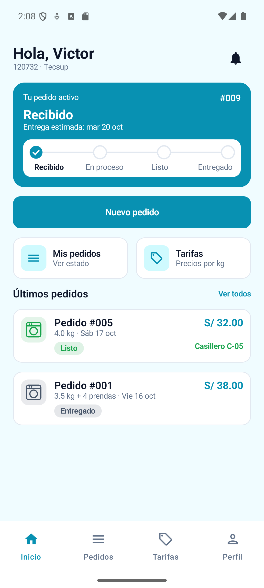
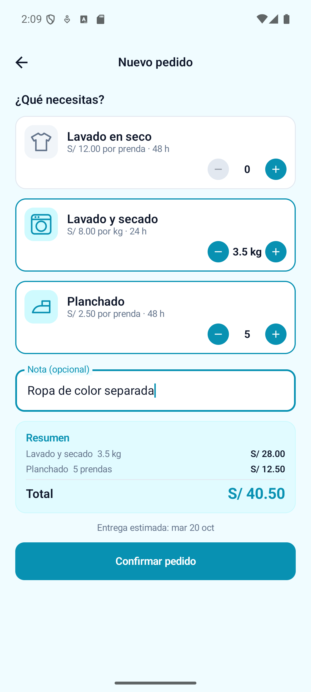
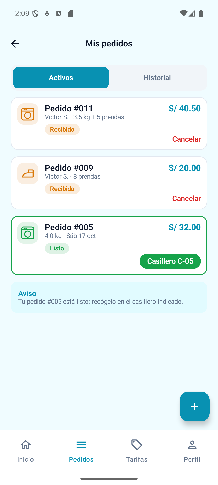
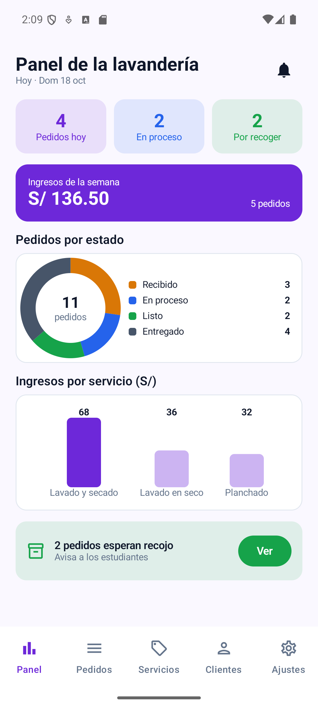
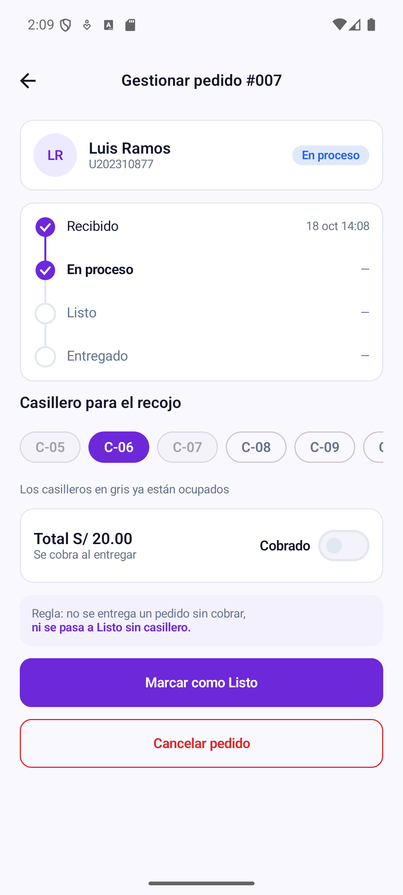
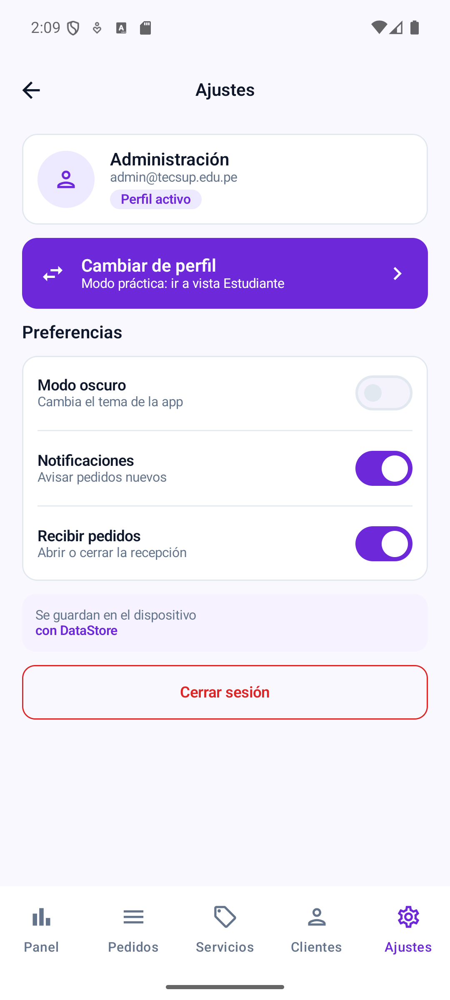
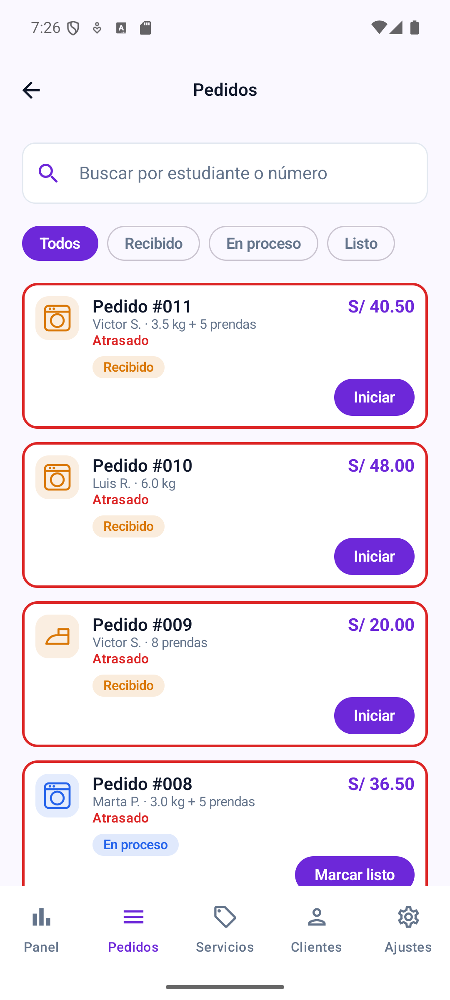
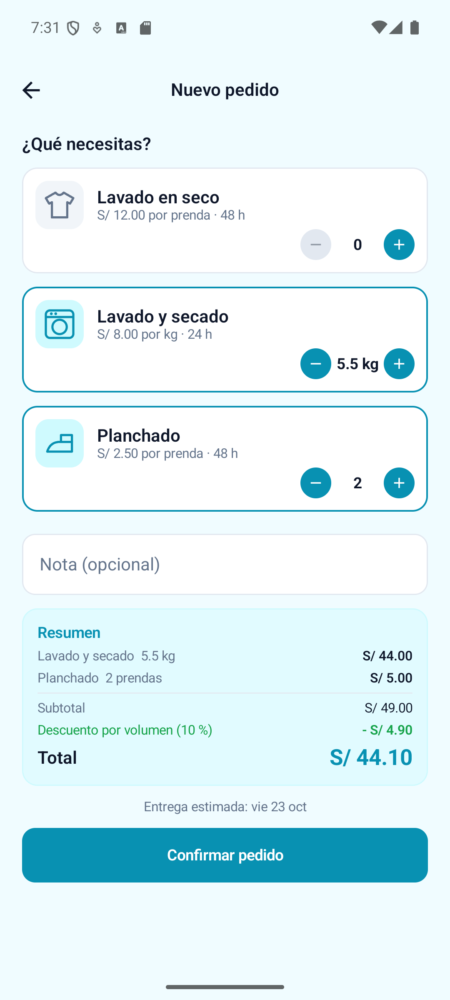
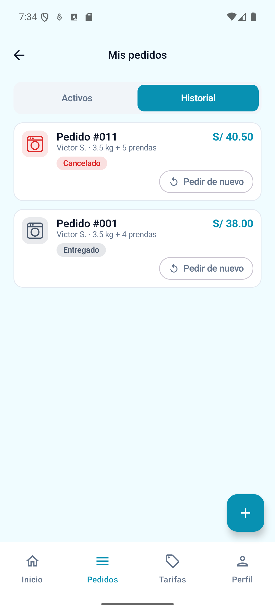
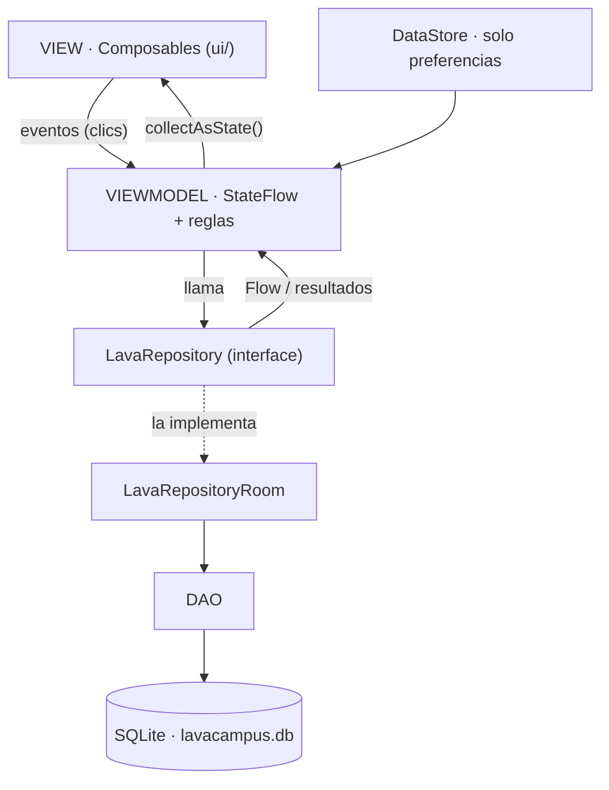

# LavaCampus — Lavandería universitaria

**Curso:** Desarrollo de Aplicaciones Móviles · Tecsup<br>
**Semana 08:** Laboratorio MVVM + Room<br>
**Alumno:** Victor Manuel Santamaria Fabian

App de la lavandería del campus con dos perfiles en el mismo dispositivo. El **estudiante** arma un pedido eligiendo servicios y cantidades (kilos o prendas), ve el total y la fecha de entrega, sigue el estado de su ropa y la recoge en un casillero. El **administrador** recibe los pedidos, los avanza de estado, asigna el casillero, cobra, administra las tarifas y consulta a sus clientes. Los dos perfiles comparten la misma base de datos Room: cuando el administrador marca un pedido como Listo, el estudiante lo ve al instante.

Kotlin · Jetpack Compose · Material 3 (sin XML) · Room · DataStore · Navigation Compose · MVVM + Repository.

## Usuarios de prueba
El inicio de sesión solo acepta correos `@tecsup.edu.pe`.

| Perfil | Correo | Clave |
|---|---|---|
| Estudiante | `victor.santamaria.f@tecsup.edu.pe` | `1234` |
| Estudiante | `luis.ramos@tecsup.edu.pe` · `marta.paredes@tecsup.edu.pe` | `1234` |
| Administrador | `admin@tecsup.edu.pe` · `jleon@tecsup.edu.pe` | `admin` |

Los datos se cargan la primera vez que se abre la app: 4 servicios (uno inactivo), 3 estudiantes, 2 administradores y 10 pedidos en distintos estados. Para volver a empezar, borrar los datos de la app.

## Requerimientos funcionales
| Requerimiento | Captura |
|---|---|
| **RF-01 · Seguimiento del pedido (estudiante)**<br>El Inicio saluda con el nombre y el código, muestra el pedido activo más reciente con su línea de seguimiento y la fecha estimada (o "Recógelo en el casillero C-xx" si está Listo), y los 2 últimos pedidos. Se actualiza solo cuando el administrador cambia el estado. | [Captura 1 · Inicio del estudiante](#capturas) |
| **RF-02 · Registrar un pedido**<br>El estudiante elige servicios activos y cantidades (kg de 1.0 a 10.0 en pasos de 0.5; prendas o unidades de 1 a 30). El total se recalcula en cada cambio y la entrega es hoy + el mayor tiempo de entrega, saltando el domingo. Sin servicios no se puede confirmar, y con 3 pedidos activos no se crea un cuarto. El pedido y sus líneas se guardan en una sola transacción. | [Captura 2 · Nuevo pedido](#capturas) |
| **RF-03 · Consultar y cancelar pedidos**<br>Mis pedidos separa Activos (Recibido, En proceso, Listo) e Historial (Entregado, Cancelado). Los pedidos Listos se destacan con su casillero. Solo se cancela un pedido Recibido, con confirmación. | [Captura 3 · Mis pedidos](#capturas) |
| **RF-04 · Panel de la lavandería**<br>Pedidos de hoy (sin cancelados), en proceso y por recoger; ingresos de la semana (pedidos pagados desde el lunes); gráfico de pedidos por estado e ingresos por servicio; alerta si hay pedidos Listos esperando recojo. | [Captura 4 · Panel de la lavandería](#capturas) |
| **RF-05 · Gestión del pedido con casillero y cobro**<br>El pedido avanza un estado a la vez y nunca retrocede. Para pasar a Listo exige un casillero libre (C-01 a C-30; los ocupados salen en gris) y para Entregado exige que esté cobrado. Se cancela solo desde Recibido o En proceso. Si una regla no se cumple, se muestra el motivo. | [Captura 5 · Gestionar pedido](#capturas) |
| **RF-06 · Ajustes, servicios y cambio de perfil**<br>Modo oscuro, notificaciones y "Recibir pedidos" se guardan con DataStore y se mantienen al cerrar la app. "Cambiar de perfil" pasa a la vista del otro rol sin volver a iniciar sesión. El administrador crea y edita servicios; un servicio que ya está en pedidos no se elimina, solo se desactiva. | [Captura 6 · Ajustes](#capturas) |

## Mejoras con IA (Fase 2, rama `con-ia`)
Las 3 mejoras mínimas de la guía, hechas con IA sin romper MVVM + Repository. Los prompts, lo que se corrigió y la reflexión están en [`PROMPTS.md`](PROMPTS.md).

| Mejora | Capas que cambian | Captura |
|---|---|---|
| **A · Pedidos atrasados**<br>Un pedido está atrasado si su fecha de entrega ya pasó y no está Entregado ni Cancelado. En la bandeja sale con borde rojo y el texto "Atrasado"; el panel muestra cuántos hay. | DAO + Repository + ViewModel + View | [Captura 7 · Bandeja con atrasados](#capturas) |
| **B · Descuento por volumen**<br>Si el lavado (servicios por kg) supera 5 kg, se descuenta el 10 % del total. Se ve en el resumen de Nuevo pedido y en el detalle, y se guarda en la columna `descuento` del pedido. | Entidad + Repository + ViewModel + View | [Captura 8 · Descuento por volumen](#capturas) |
| **C · Repetir un pedido**<br>En el historial, "Pedir de nuevo" abre Nuevo pedido con las mismas líneas y cantidades, pero con los precios actuales. Si un servicio ya no está activo, no se carga y se avisa. | ViewModel + View | [Captura 9 · Pedir de nuevo](#capturas) |

## Capturas
Tomadas en el emulador (Pixel 8) con los datos de prueba, en modo claro.

**Estudiante**

|  |  |  |
|:---:|:---:|:---:|
| **Captura 1 · Inicio del estudiante**<br>RF-01 | **Captura 2 · Nuevo pedido**<br>RF-02 | **Captura 3 · Mis pedidos**<br>RF-03 |

**Administrador**

|  |  |  |
|:---:|:---:|:---:|
| **Captura 4 · Panel de la lavandería**<br>RF-04 | **Captura 5 · Gestionar pedido**<br>RF-05 | **Captura 6 · Ajustes**<br>RF-06 |

**Mejoras con IA**

|  |  |  |
|:---:|:---:|:---:|
| **Captura 7 · Bandeja con atrasados**<br>Mejora A | **Captura 8 · Descuento por volumen**<br>Mejora B | **Captura 9 · Pedir de nuevo**<br>Mejora C |

## Arquitectura (MVVM + Repository)


| Capa | Conoce a | No debe |
|---|---|---|
| View (`ui/`) | Solo a su ViewModel | Usar DAO, Repository ni reglas de negocio |
| ViewModel | Solo al Repository (interface) | Conocer Composables ni el DAO |
| Repository | Los DAOs (en la implementación) | Conocer pantallas ni ViewModels |
| DAO / Room | SQL y entidades | Conocer ViewModels |

Lectura que debe actualizar la pantalla → `Flow`. Escritura o acción única → `suspend`.

## Estructura de paquetes
```
tecsup.santamaria.lavacampus
├── MainActivity.kt · LavaApp.kt          base de datos, repository y preferencias
├── data
│   ├── local
│   │   ├── entity      Servicio · Usuario · Pedido · DetallePedido
│   │   ├── dao         ServicioDao · UsuarioDao · PedidoDao · DetalleDao
│   │   ├── relation    PedidoConDetalle · DetalleConServicio
│   │   ├── LavaDatabase.kt
│   │   └── DatosIniciales.kt
│   ├── prefs           PreferenciasStore (DataStore)
│   └── repository      LavaRepository (interface) · LavaRepositoryRoom
├── model               Rol · EstadoPedido · Unidad · LineaPedido · IngresoServicio · ClienteResumen · Casilleros
├── viewmodel           Sesion · Inicio · NuevoPedido · DetallePedido · MisPedidos · Panel · Bandeja
│                       GestionPedido · Servicios · Clientes · LavaViewModelFactory
└── ui
    ├── theme           Color · Type · Theme (LavaTheme por rol, claro y oscuro)
    ├── navigation      Rutas · NavLava (grafo del estudiante y del administrador)
    ├── components      AppTopBar · LavaButton · LavaTextField · LavaSwitch · EstadoPedidoChip · PedidoCard
    │                   StepperEstado · IconoServicio · SelectorCantidad · SelectorSegmentado · Preferencias · Formatos
    │   └── graficos    DatoGrafico · GraficoDona · GraficoBarras
    ├── estudiante      Splash · Login · Inicio · NuevoPedido · DetallePedido · MisPedidos · Tarifas · Perfil
    └── administrador   Panel · Bandeja · GestionPedido · Servicios · FormularioServicio · Clientes · Ajustes
```

## Ramas
| Rama | Fase |
|---|---|
| `sin-ia` | Fase 1: desarrollo sin asistente de IA (la guía la llama `main`) |
| `con-ia` | Fase 2: mejoras con IA + [`PROMPTS.md`](PROMPTS.md) (la guía la llama `mejora-ia`) |

## Diferencias con la guía
- **Room 2.7.2** en vez de 2.6.1: la 2.6.1 no compila con Kotlin 2.2 y KSP2. Proyecto con AGP 9.4.1, Kotlin 2.2.10 y minSdk 26 (`java.time`).
- **Correos `@tecsup.edu.pe`** en vez de `@correo.test` y `@lavacampus.test`, y el login rechaza otros dominios (pedido del docente).
- **La interface `LavaRepository` tiene dos funciones más**, declaradas primero en la interface:
  - `obtenerUsuario(id)`: recupera al usuario cuando la app se abre con la sesión guardada.
  - `primerUsuarioDeRol(rol)`: "Cambiar de perfil" pasa al primer usuario del otro rol.
- **Seguimiento:** la tabla `pedidos` solo guarda la hora de registro, así que solo la etapa Recibido muestra hora.
- **Los servicios se listan por nombre**, como en el `ServicioDao` de la guía.
- **Base de datos en versión 2** (Fase 2): el descuento agrega la columna `descuento` a `pedidos` con una migración, así no se pierden los pedidos guardados.
- **Descuento por volumen:** la guía no dice sobre qué monto se aplica el 10 %; se aplica al total del pedido. "Supera 5 kg" se toma literal: 5.0 kg no tiene descuento, 5.5 kg sí.
