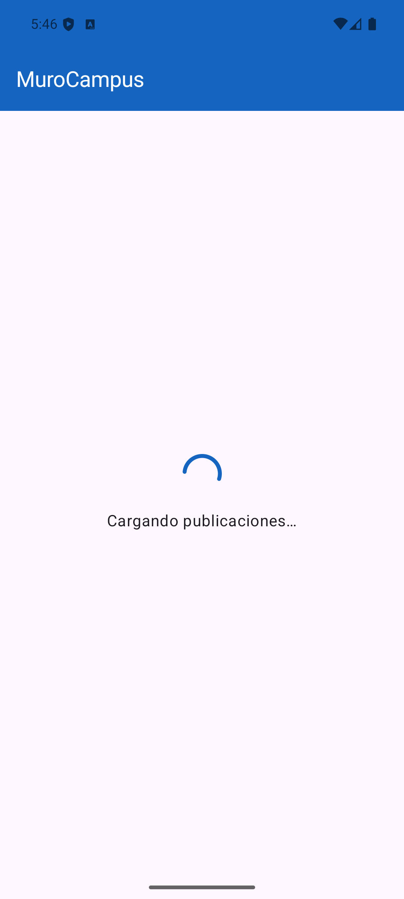
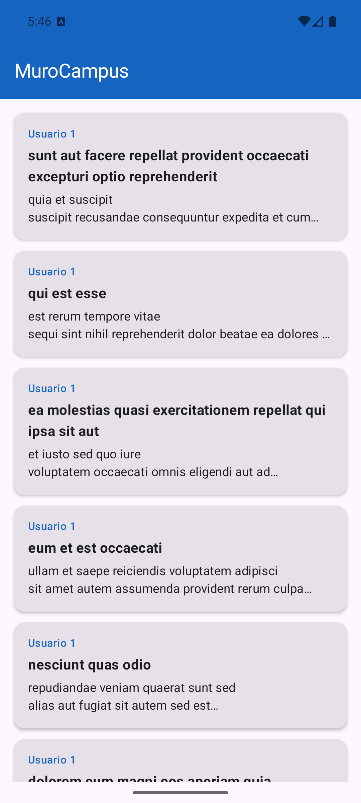
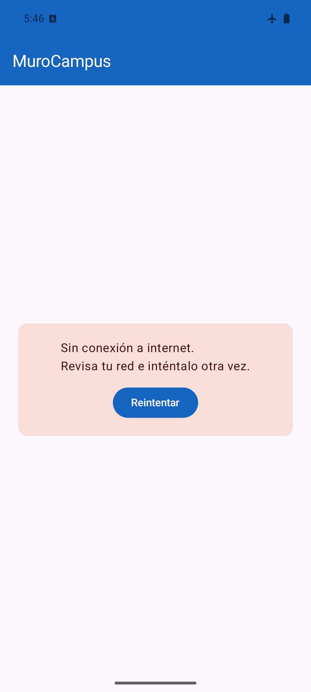
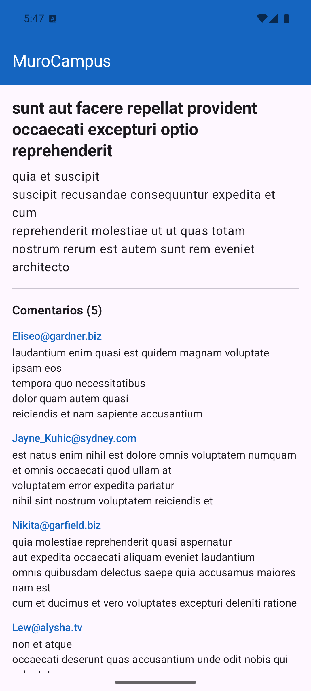
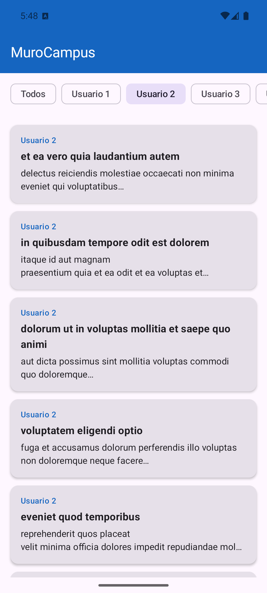
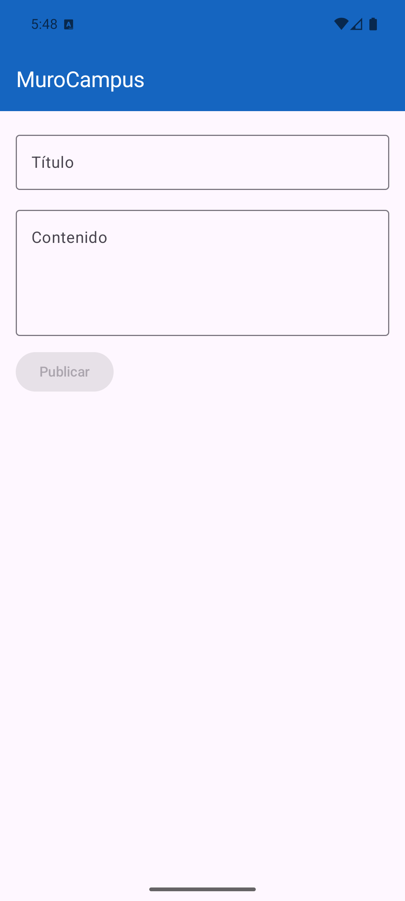
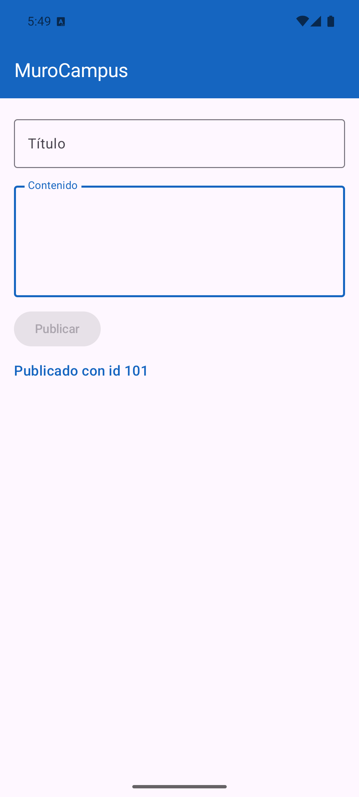
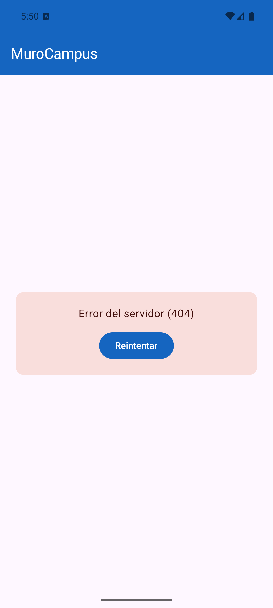
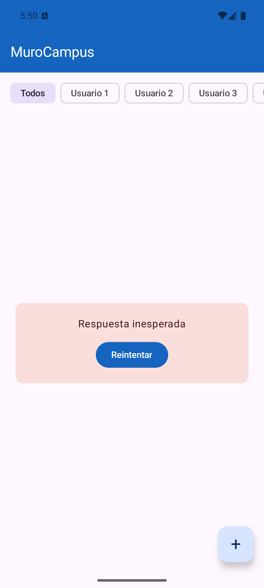
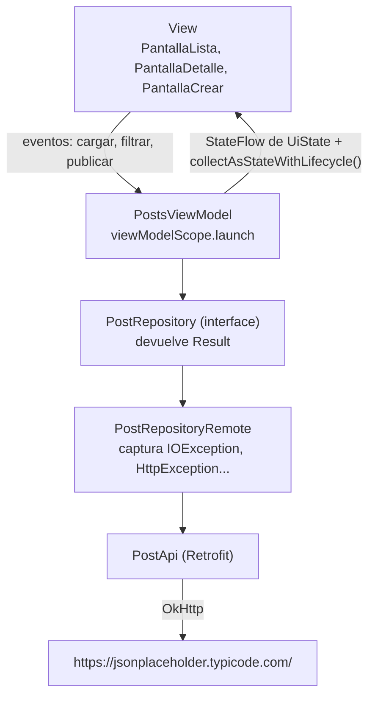

# MuroCampus - Servicios Web y plataforma REST | SIN IA

Laboratorio 09 de Programación en Móviles (Tecsup, docente Juan León): **Servicios Web y plataforma REST**.
Autor: Victor Santamaria.

Aplicación Android desarrollada con **Kotlin, Jetpack Compose, Retrofit, OkHttp y kotlinx.serialization**.

Esta carpeta corresponde a la **Fase 1 (SIN IA)**. MuroCampus es un muro de publicaciones que viene de internet: consume el servicio REST de práctica JSONPlaceholder, lista las publicaciones, muestra el detalle con sus comentarios, filtra por usuario y crea una publicación nueva. También se comporta bien cuando no hay internet. La pantalla nunca llama a Retrofit: habla con el `ViewModel`, y este con el `Repository`.

---

## Requerimientos funcionales

### RF01 - Lista de publicaciones con estados

Mostrar las publicaciones del servicio con los tres estados de una llamada de red.

Debe permitir:

- Ver el indicador de carga y el texto **Cargando publicaciones…** mientras llega la respuesta.
- Ver una tarjeta por publicación: etiqueta **Usuario N**, título en negrita y las primeras líneas del texto (`maxLines = 2`).
- Ver un recuadro de error con el mensaje y el botón **Reintentar** si la llamada falla.

**Evidencia (carga, lista y error de conexión):**







---

### RF02 - Detalle con comentarios

Al tocar una publicación se muestra su detalle y sus comentarios.

Se usa `GET posts/{id}` y `GET posts/{id}/comments` con `@Path("id")`. Las dos llamadas salen a la vez con `async` dentro de `coroutineScope`; si una falla, todo el detalle muestra el error con **Reintentar**.

La pantalla presenta:

- Título y texto completos.
- **Comentarios (N)** con el correo (en azul) y el texto de cada comentario.

El botón Atrás del sistema (`BackHandler`) vuelve a la lista sin recargarla.

**Evidencia:**



---

### RF03 - Filtro por usuario

Mostrar solo las publicaciones del usuario elegido.

Una fila desplazable de `FilterChip` ofrece **Todos** y **Usuario 1** a **Usuario 10**; el seleccionado se ve marcado. Usa `GET posts?userId=2` con `@Query("userId")`. Si el filtro devuelve una lista vacía se muestra **Sin publicaciones**.

**Evidencia (Usuario 2):**



---

### RF04 - Crear una publicación

Enviar una publicación nueva al servicio y mostrar la respuesta.

Debe permitir:

- Escribir **Título** y **Contenido** en dos `OutlinedTextField`.
- Pulsar **Publicar**, deshabilitado si el título o el contenido están vacíos (`isNotBlank()`).
- Ver **Publicado con id 101** y que el formulario se limpie. Si falla, se muestra el mensaje y se conserva lo escrito.

Se envía `POST posts` con `@Body` (`NuevoPost` no lleva `id`). Se abre con el botón flotante **+** de la lista. JSONPlaceholder simula el POST: responde 201 con id 101 pero no guarda nada.

**Evidencia:**





---

### RF05 - Errores sin cerrar la app

Ninguna falla cierra la aplicación. El Repository convierte toda excepción en `Result.failure` y el ViewModel la transforma en un mensaje con `mensajeDe`:

| Falla | Mensaje |
|---|---|
| Sin internet (`IOException`) | Sin conexión a internet. Revisa tu red e inténtalo otra vez. |
| Recurso inexistente (`HttpException`) | Error del servidor (404) |
| JSON que no coincide (`SerializationException`) | Respuesta inesperada |

**Evidencia (404 y JSON inesperado, provocados de forma temporal):**





---

## Flujo de la aplicación

    ABRIR LA APP
      ↓
    LISTA  (Cargando → Éxito | Error + Reintentar)
      ├── chips Todos / Usuario 1..10 → recarga con posts?userId=N
      ├── tocar tarjeta
      │      ↓
      │   DETALLE  (posts/{id} + posts/{id}/comments a la vez)
      │      ↓
      │    ATRÁS → LISTA (sin recargar)
      │
      └── botón +
             ↓
          CREAR  (Publicar → POST posts → "Publicado con id 101")
             ↓
          ATRÁS → LISTA

---

## Estructura de paquetes

```
com.tecsup.murocampus/
├── MainActivity.kt
├── model/
│   └── Modelos.kt                  Post, Comentario, NuevoPost (+ Usuario)
├── data/
│   ├── remote/
│   │   ├── PostApi.kt              la interface de Retrofit
│   │   ├── RetrofitClient.kt       OkHttp + conversor JSON, una sola vez
│   │   └── UsuarioApi.kt           ejemplo resuelto
│   ├── PostRepository.kt           interface + PostRepositoryRemote (devuelve Result)
│   └── UsuarioRepository.kt        ejemplo resuelto
├── viewmodel/
│   ├── UiState.kt                  Cargando / Exito / Error y mensajeDe
│   ├── PostsViewModel.kt           lista, detalle, filtro y crear
│   └── PostsViewModelFactory.kt
└── ui/
    ├── Componentes.kt              TarjetaPost, Cargando, ErrorConReintento
    ├── PantallaLista.kt
    ├── PantallaDetalle.kt
    ├── PantallaCrear.kt
    └── theme/
```

## Arquitectura (MVVM + Repository)



| Capa | Conoce a | NO debe |
|---|---|---|
| View (`ui/`) | Solo a su ViewModel | Llamar a Retrofit ni conocer `PostApi` |
| ViewModel | Solo a la interface `PostRepository` | Conocer Retrofit, `HttpException` ni `Context` |
| Repository | `PostApi` y las excepciones de red | Conocer la UI ni dejar escapar excepciones: devuelve `Result` |
| `data/remote` | Retrofit, OkHttp y el JSON | Guardar estado de pantalla |

---

## Pruebas de errores (Paso 10)

| Prueba | Cómo se provocó | Resultado | OK |
|---|---|---|---|
| Sin internet | Modo avión y abrir la app | Sin conexión a internet y botón Reintentar | ✔ |
| Reintentar | Quitar el modo avión y pulsar Reintentar | Carga la lista | ✔ |
| Recurso inexistente | Pedir `posts/9999` en el detalle (temporal) | Error del servidor (404) | ✔ |
| JSON inesperado | Agregar a `Post` un campo que no llega (temporal) | Respuesta inesperada | ✔ |
| Cancelación | Abrir el detalle y volver rápido (dos veces) | Sin errores en Logcat | ✔ |
| Rotación | Rotar la pantalla | No vuelve a descargar (0 llamadas) | ✔ |
| Lista y detalle | Publicación 1 en la app; 1, 7, 50 y 100 contra la API | Siempre 5 comentarios | ✔ |
| Filtro | Usuario 2 en la app; usuarios 1 a 10 contra la API | Siempre 10 publicaciones | ✔ |
| Crear | Enviar una publicación | Publicado con id 101 (POST → 201 en Logcat) | ✔ |
| Código | Buscar en `viewmodel/` | No hay Retrofit, `PostApi`, `HttpException` ni `Context` | ✔ |

Los cambios temporales de las pruebas se deshicieron antes de los commits.

---

## Para pensar

**1. ¿Qué diferencia hay entre GET y POST? ¿Por qué crear lleva `@Body` y `porUsuario` lleva `@Query`?**
GET lee un recurso y no cambia nada en el servidor; POST crea uno nuevo. `crear` lleva `@Body` porque los datos de la publicación viajan como JSON en el cuerpo de la petición. `porUsuario` lleva `@Query` porque `userId` es solo un criterio para filtrar una lectura y va en la URL (`posts?userId=2`).

**2. ¿Por qué la ruta es `"posts"` y no `"/posts"`?**
Porque una ruta que empieza con `/` reemplaza todo el camino de la URL base. Sin la barra, Retrofit la une a la base `https://jsonplaceholder.typicode.com/` y arma la URL completa.

**3. ¿Por qué el Repository devuelve `Result` en vez de dejar que la excepción llegue al ViewModel?**
Para que ninguna falla de red cierre la app y para que el ViewModel no conozca `HttpException` ni `IOException` (es decir, Retrofit). El Repository captura el error y lo devuelve como `Result.failure`; el ViewModel solo lo convierte en un `UiState` y la pantalla lo dibuja.

**4. ¿Qué pasa si olvidas el permiso `INTERNET`? ¿Y si olvidas `ignoreUnknownKeys` y el servidor agrega un campo nuevo?**
Sin el permiso la app compila pero nunca se conecta: aparece un error de red aunque haya internet. Sin `ignoreUnknownKeys = true`, un campo nuevo en el JSON hace que la conversión falle con `SerializationException` ("Respuesta inesperada"), aunque la app no use ese campo.

**5. ¿Por qué la pantalla de lista usa un `when` sobre `UiState` y no un `if` con tres variables?**
Porque `UiState` es una `sealed interface`: solo puede estar en un estado a la vez y el compilador obliga a cubrirlos todos. Con tres variables (`cargando`, `error`, `datos`) se pueden dar combinaciones imposibles, como cargando y con error al mismo tiempo.

**6. JSONPlaceholder no guarda los POST. ¿Cómo cambiaría tu app si usaras un servicio real?**
La interface, el Repository y la pantalla casi no cambiarían: solo la `baseUrl` y, según el servicio, la autenticación (por ejemplo un token en un interceptor de OkHttp). Lo que sí cambiaría es que la publicación nueva aparecería al recargar la lista y habría que decidir si se agrega a la lista local o se vuelve a pedir al servidor. Se manejarían además más errores, como 401, 403 o 422.
