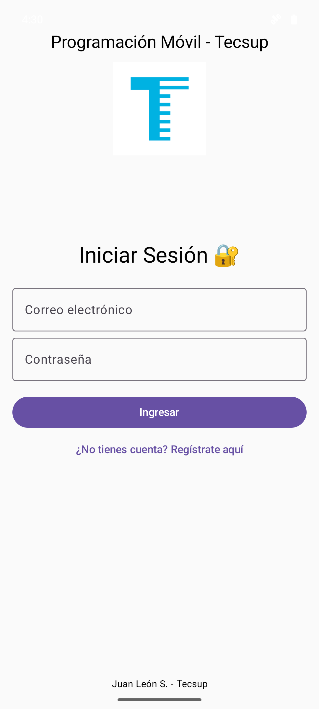
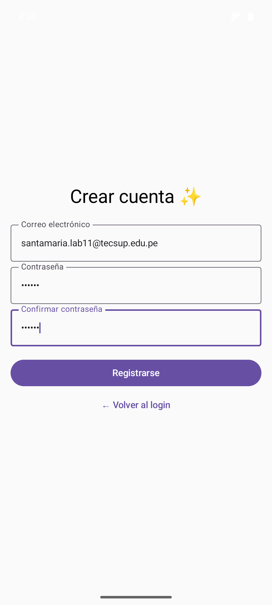
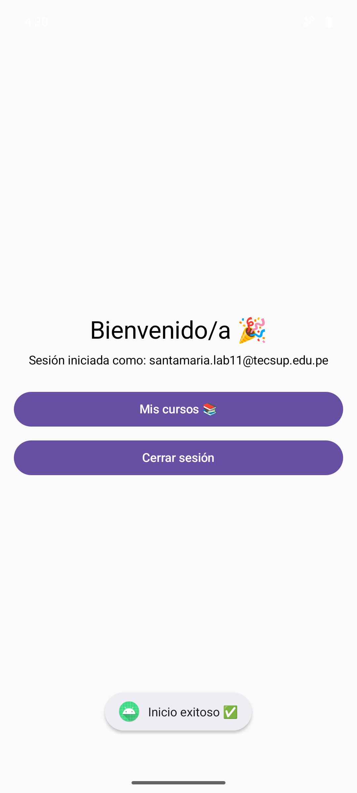
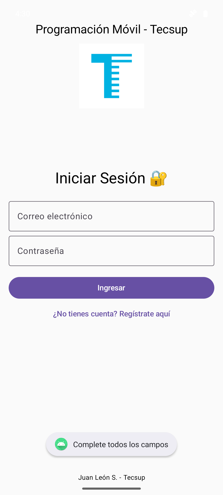
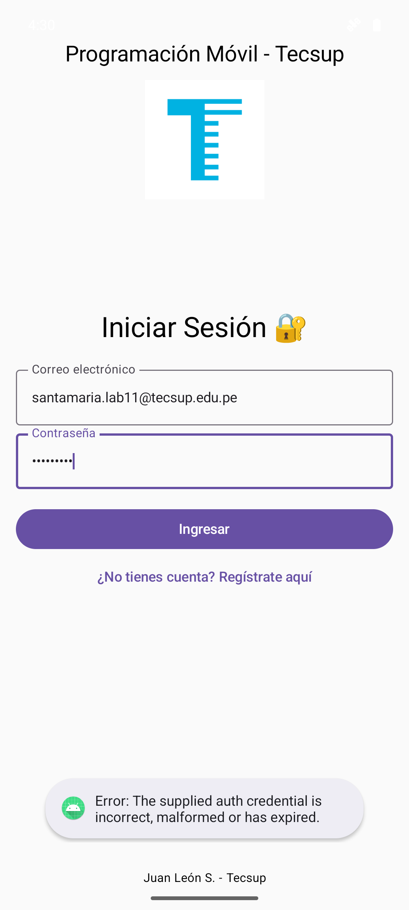
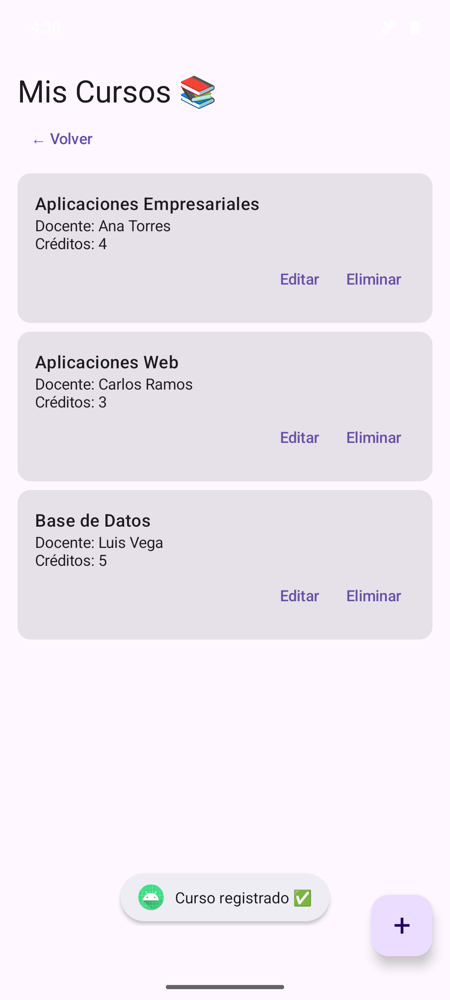
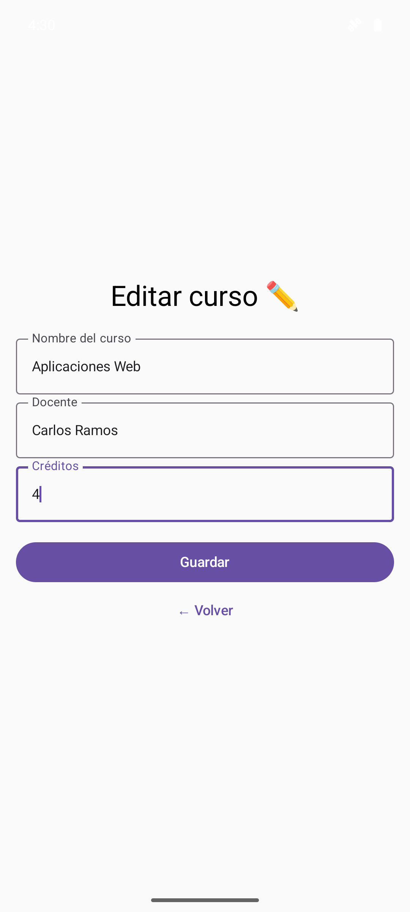

# AuthFirebaseAppSantamaria — Login con Firebase

**Curso:** Desarrollo de Aplicaciones Móviles · Tecsup<br>
**Semana 11:** Laboratorio 11, Firebase Authentication<br>
**Alumno:** Victor Manuel Santamaria Fabian

App de inicio de sesión conectada a **Firebase Authentication** con correo y contraseña. El usuario se registra o ingresa con una cuenta que vive en Firebase (no en el celular), llega a una pantalla de bienvenida con su correo y puede cerrar sesión. Los usuarios se pueden crear desde la pantalla de registro de la app o desde la consola de Firebase (Authentication → Usuarios → Agregar usuario); el login funciona igual con los dos.

Kotlin · Jetpack Compose · Material 3 (sin XML) · Firebase Authentication · Navigation Compose.

## Usuarios de prueba
| Correo | Clave |
|---|---|
| `santamaria.lab11@tecsup.edu.pe` | `123456` |
| `prueba.lab11@tecsup.edu.pe` | `123456` |

Para entrar con otra cuenta se registra desde la app o se crea en la consola. Firebase pide una clave de 6 caracteres como mínimo.

## Requerimientos funcionales
| Requerimiento | Captura |
|---|---|
| **RF-01 · Iniciar sesión**<br>Login con correo y contraseña contra Firebase (`signInWithEmailAndPassword`). Con datos correctos pasa a la bienvenida; mientras espera, el botón dice "Cargando..." y se desactiva. | [Captura 1 · Login](#capturas) |
| **RF-02 · Registrar usuario**<br>Correo, contraseña y confirmación. Valida campos vacíos, que las claves coincidan y un mínimo de 6 caracteres; luego crea la cuenta en Firebase (`createUserWithEmailAndPassword`) y entra directo a la bienvenida. | [Captura 2 · Registro](#capturas) |
| **RF-03 · Bienvenida y cerrar sesión**<br>Muestra el correo del usuario autenticado. "Cerrar sesión" llama a `signOut()` y vuelve al login sin poder regresar con el botón atrás. | [Captura 3 · Bienvenida](#capturas) |
| **RF-04 · Validaciones y errores**<br>Si faltan campos, avisa con un Toast sin llamar a Firebase. Si la clave es incorrecta, muestra el mensaje que devuelve Firebase. | [Capturas 4 y 5](#capturas) |

## Capturas
Tomadas en el emulador (Pixel 8) con el usuario `santamaria.lab11@tecsup.edu.pe`.

|  |  |  |
|:---:|:---:|:---:|
| **Captura 1 · Login**<br>RF-01 | **Captura 2 · Registro**<br>RF-02 | **Captura 3 · Bienvenida**<br>RF-03 |

|  |  |
|:---:|:---:|
| **Captura 4 · Campos vacíos**<br>RF-04 | **Captura 5 · Credenciales incorrectas**<br>RF-04 |

## Configuración de Firebase
1. Proyecto en la consola de Firebase (**Firebase Android Studio**) con una app Android registrada con el paquete `com.tecsup.authfirebaseappsantamaria`. Tiene que ser igual al `applicationId`.
2. `google-services.json` descargado de la consola y colocado en `app/`. Con otro nombre o en otra carpeta, Gradle no lo encuentra.
3. **Authentication → Método de acceso → Correo electrónico/contraseña** activado. Sin esto, el registro falla con `CONFIGURATION_NOT_FOUND`.

Dependencias (como en la guía):
- Plugin `com.google.gms.google-services` 4.4.2 (proyecto y módulo `app`).
- Firebase BoM 33.1.0 + `firebase-auth-ktx`.
- `navigation-compose` 2.8.0.

## Estructura del proyecto
```
com.tecsup.authfirebaseappsantamaria
├── MainActivity.kt      inicializa Firebase y carga AuthApp
├── AuthApp.kt           Destinations y NavHost (login, register, home)
├── LoginScreen.kt       título, logo Tecsup, correo, contraseña e Ingresar
├── RegisterScreen.kt    correo, contraseña, confirmación y Registrarse
├── HomeScreen.kt        bienvenida, correo del usuario y Cerrar sesión
├── Curso.kt             extra: modelo del curso
├── CursosScreen.kt      extra: lista, editar y eliminar
└── CursoFormScreen.kt   extra: registrar y editar
```
La parte de autenticación respeta la estructura de la guía: pantallas sueltas en el paquete y Firebase llamado desde los composables.

## Extra: Mis Cursos (Cloud Firestore)
La guía propone una actividad "Mis Cursos – App con Autenticación y CRUD en la Nube". El docente indicó que no era obligatoria; quedó hecha como extra.

Desde la bienvenida, "Mis cursos" abre la lista de cursos del usuario. Se registran, editan y eliminan (con confirmación) en la colección `cursos` de Firestore, y la lista se actualiza sola. Cada curso guarda el `userId` de quien lo creó: la app filtra por ese campo y las reglas de Firestore no dejan leer ni modificar los cursos de otro usuario.

|  |  |
|:---:|:---:|
| **Captura 6 · Mis cursos** | **Captura 7 · Editar curso** |

Reglas de Firestore usadas:
```
match /cursos/{cursoId} {
  allow read, update, delete: if request.auth != null && request.auth.uid == resource.data.userId;
  allow create: if request.auth != null && request.auth.uid == request.resource.data.userId;
}
```

## Rama
`sin-ia`, igual que la fase 1 de los labs anteriores.

## Diferencias con la guía
- **Nombre y paquete con el apellido:** `AuthFirebaseAppSantamaria` y `com.tecsup.authfirebaseappsantamaria`, porque la guía pide que el proyecto lleve el apellido del alumno.
- **Gradle:** AGP 9.4.1, `compileSdk` y `targetSdk` 37 y minSdk 26, igual que los otros labs del repo. Con AGP 9 Kotlin viene integrado, así que no va `kotlinOptions`.
- **Firebase BoM 33.1.0** aunque la consola sugiere la 35.1.0: desde la BoM 34 ya no existe `firebase-auth-ktx`, que es la que usa la guía.
- **Logo:** `res/drawable/tecsup.png`, que la guía usa en el login (`R.drawable.tecsup`).
