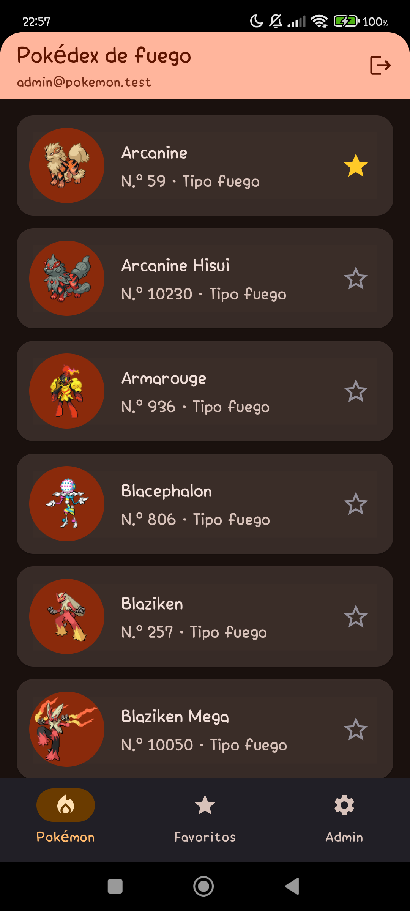
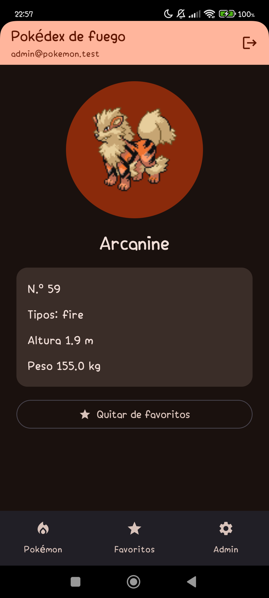
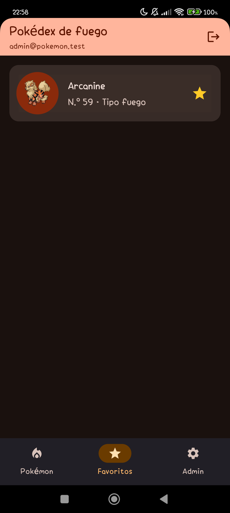
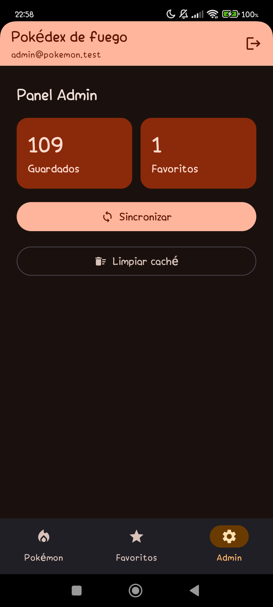

# Pokédex — Laboratorio 12 (Programación en Móviles)

App Android en Kotlin con Jetpack Compose (Material 3) que muestra los Pokémon de tipo **fuego** desde internet, los guarda en el celular y permite marcar favoritos.

**Integrantes:** Victor y Diego Panez · **Tema:** Pokémon, variante fuego · **API:** [PokeAPI](https://pokeapi.co/api/v2/) (sin clave)

## Qué hace

| Función | Estado |
|---|---|
| Lista de Pokémon de fuego con estados Cargando, Error (con *Reintentar*) y Vacío | Hecho |
| Detalle de un Pokémon con el segundo endpoint (`pokemon/{nombre}`) | Hecho |
| Room como fuente de verdad (Entity, Dao, Database) y modo sin conexión | Hecho |
| Favoritos: marcar, desmarcar y pantalla Favoritos (se conservan al cerrar la app) | Hecho |
| Panel Admin (solo administrador): totales, *Sincronizar* y *Limpiar caché* | Hecho |
| Login con Firebase Authentication, sesión guardada, cerrar sesión y roles desde Firestore (`usuarios/{uid}`, campo `rol`) | Hecho |
| Notificación local «Se guardaron N elementos» al sincronizar | Hecho |

## Endpoints

- Lista: `GET type/fire` → `pokemon[].pokemon.{name, url}`
- Detalle: `GET pokemon/{nombre}`

El id de cada elemento es el nombre del Pokémon (texto).

## Arquitectura (MVVM)

```
com.tecsup.pokemon/
├── data/
│   ├── remote/        ApiService, RetrofitClient, DTO
│   ├── local/         ItemEntity, ItemDao, AppDatabase (Room)
│   ├── mapper/        Dto → Entity → modelo
│   ├── repository/    ItemRepository (interface) + ItemRepositoryImpl
│   └── auth/          AuthRepository (interface)
├── domain/model/      Item, Sesion y Rol
├── notification/      Notificador (interface)
└── ui/
    ├── UiState.kt     Cargando · Exito · Error
    ├── navigation/    AppNav
    ├── lista/ detalle/ favoritos/ admin/    Screen + ViewModel de cada pantalla
    └── components/    Cargando, ErrorView
```

- Las pantallas solo observan un `StateFlow<UiState>` y llaman funciones del ViewModel.
- El ViewModel depende del repositorio como **interface**; Room es la fuente de verdad y Retrofit solo la actualiza con `refrescar()`.
- El panel Admin solo existe en la navegación cuando la sesión tiene el rol `ADMIN`.

## Pruebas

Pruebas unitarias de los ViewModel con un repositorio falso en memoria (`FakeItemRepository`), sin red ni Room:

- `ListaViewModelTest` (5): datos guardados, sin internet sin datos, sin internet con datos, reintentar y favorito.
- `DetalleViewModelTest` (4): carga, sin internet, error HTTP y favorito.
- `FavoritosViewModelTest` (2): solo favoritos y quitar un favorito.
- `AdminViewModelTest` (4): totales, sincronizar con aviso, sincronizar sin internet y limpiar caché.

```bash
./gradlew :app:testDebugUnitTest
```

## Cómo ejecutarlo

1. Abrir la carpeta `Semana_12/Lab12` en Android Studio.
2. Tener internet en el emulador o el celular.
3. Ejecutar la configuración `app`.

`google-services.json` (Firebase) no se sube al repositorio: se coloca en `app/` (lo crea quien tiene el proyecto de Firebase y se lo pasa al otro por privado). Sin ese archivo la app no compila.

## Capturas

Tomadas en un celular real con la sesión del administrador.

| Lista | Detalle |
|---|---|
|  |  |

| Favoritos | Panel Admin |
|---|---|
|  |  |

## Fases

- **Fase 1, sin IA:** rama `sin-ia`.
- **Fase 2, con IA:** rama `con-ia`, con `PROMPTS.md`.
