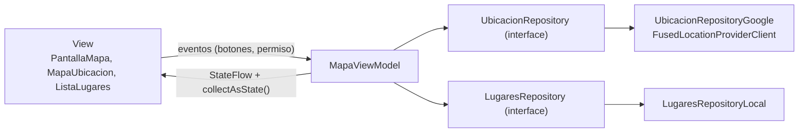
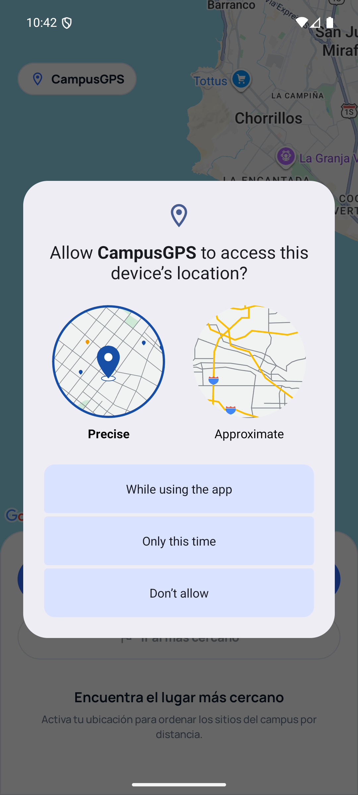
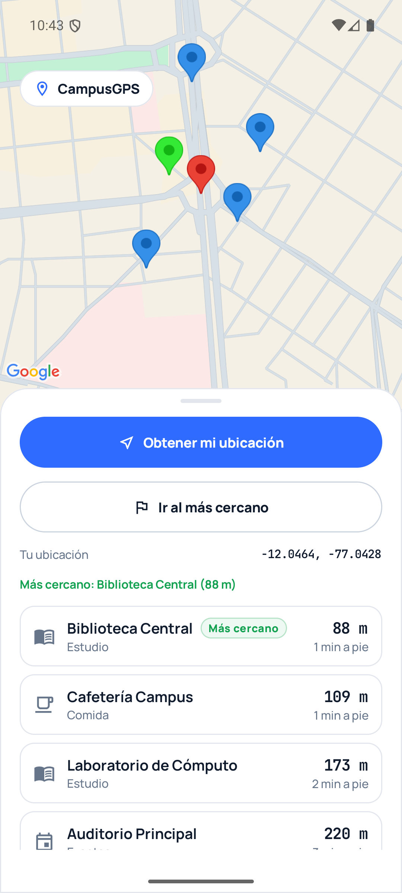
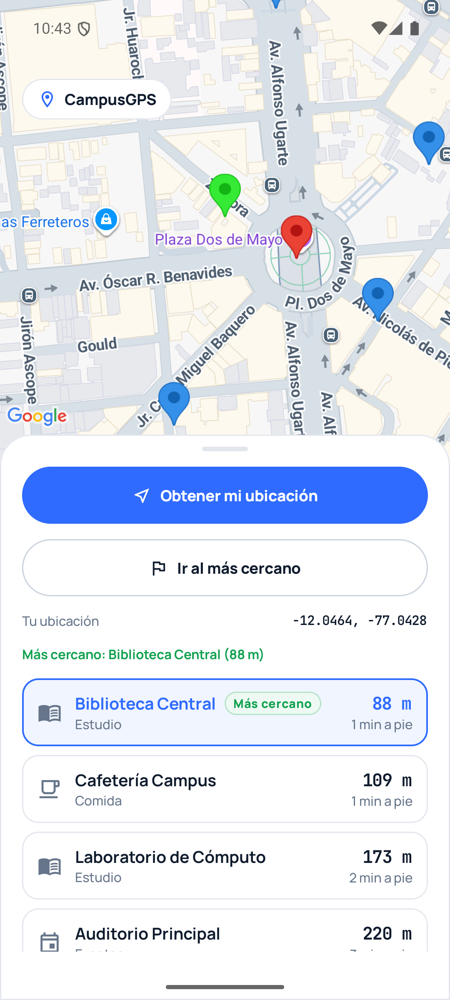
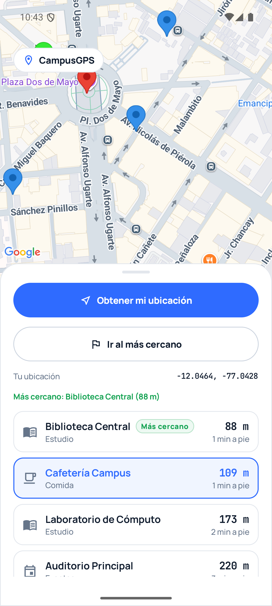
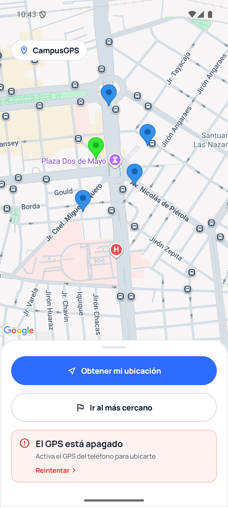

# CampusGPS

Laboratorio 13 de Programación en Móviles (Tecsup, docente Juan León): **Localización y mapas**.
Autor: Victor Santamaria.

CampusGPS pide el permiso de ubicación, te ubica con el GPS, muestra un mapa de Google con tu posición y los lugares del campus, los ordena por distancia y te lleva al más cercano. Está hecha en Kotlin + Jetpack Compose + Material 3, con `ViewModel` y `StateFlow`. Los lugares son ficticios y están guardados en el código.

## Estructura

```
com.santamaria.campusgps/
├── MainActivity.kt
├── model/
│   └── Modelos.kt                       Posicion, Lugar, LugarConDistancia, estados y TipoError
├── data/
│   ├── UbicacionRepository.kt           interface
│   ├── UbicacionRepositoryGoogle.kt     FusedLocationProviderClient
│   ├── GpsApagadoException.kt           error propio para el GPS apagado
│   ├── LugaresRepository.kt             interface
│   └── LugaresRepositoryLocal.kt        los 5 lugares del campus
├── viewmodel/
│   ├── MapaViewModel.kt                 estado, distancias, más cercano
│   └── CampusViewModelFactory.kt
├── util/
│   ├── Distancia.kt                     Location.distanceBetween
│   └── Formato.kt                       "350 m", "1.5 km", "N min a pie"
└── ui/
    ├── PantallaMapa.kt                  permiso, botones y hoja inferior
    ├── MapaUbicacion.kt                 GoogleMap y marcadores
    ├── ListaLugares.kt                  LazyColumn de lugares
    ├── MensajeError.kt                  errores con su acción
    ├── components/                      botones, caja de mensaje, insignia
    └── theme/                           colores, tipografía y formas del diseño
```

## Arquitectura (MVVM + Repository)



- La **View** dibuja el estado y avisa eventos. El cuadro del permiso lo dibuja Android.
- El **ViewModel** guarda el estado, calcula y ordena las distancias y deriva el lugar más cercano. No recibe `Context`.
- El **Repository** es el único que conoce `FusedLocationProviderClient`; si mañana cambia el proveedor del mapa o de la ubicación, el ViewModel no se entera.

## La clave de Google Maps

La clave **no está en el repositorio**: vive en `local.properties` (`MAPS_API_KEY=...`), que está en `.gitignore`. El `build.gradle.kts` la lee y la pone en el manifiesto con `manifestPlaceholders`. En Google Cloud está restringida al paquete `com.santamaria.campusgps` y al SHA-1 de la app. Para correrlo hay que poner la propia clave en `local.properties`; sin una clave válida el mapa sale vacío, pero la app no se cierra.

## Capturas

| Permiso de ubicación | Mapa con mi ubicación |
|---|---|
|  |  |

| Ir al más cercano | Lista y selección |
|---|---|
|  |  |

| GPS apagado |
|---|
|  |

Colores de los marcadores: **rojo** = tú, **azul** = lugares del campus, **verde** = el más cercano.

## Pruebas de aceptación (emulador, ubicación fija en -12.0464, -77.0428)

| Prueba | Resultado |
|---|---|
| Primera vez: pulsar **Obtener mi ubicación** | Android muestra el cuadro de permiso |
| Aceptar el permiso | Mapa en tu posición con marcador rojo y las coordenadas |
| Lugares en el mapa | 5 marcadores azules con nombre y categoría |
| Lista ordenada | Biblioteca Central 88 m, Cafetería Campus 109 m, Laboratorio de Cómputo 173 m, Auditorio Principal 220 m, el último 266 m |
| Antes de ubicarte | **Ir al más cercano** está deshabilitado |
| **Ir al más cercano** | La cámara va a la Biblioteca Central, marcador verde e insignia "Más cercano" |
| Tocar una fila de la lista | La fila se resalta y la cámara va a ese lugar |
| Negar el permiso | Mensaje de permiso con **Abrir ajustes** (abre la información de la app) |
| GPS apagado + **Reintentar** | Mensaje "El GPS está apagado"; al encenderlo y reintentar llega a la lista |
| Rotar la pantalla | Se mantienen la ubicación, la lista y el más cercano |
| `git grep` de la clave de Maps en `Lab13` | Sin resultados |
| Sin Google Play Services | **No se probó**: el emulador sí lo tiene; el código lo maneja con un mensaje sin botón |

## Para pensar

**1. ¿Por qué `FusedLocationProviderClient` está en el Repository y no en el ViewModel?**
Porque es una pieza de Android/Google que necesita `Context`. El ViewModel no debe conocer `Context` ni librerías de plataforma: así se puede probar sin un teléfono y cambiar la fuente de ubicación (otro proveedor, o una falsa para pruebas) sin tocar la lógica.

**2. ¿Qué diferencia hay entre el permiso de ubicación y la clave de API de Maps? ¿Qué pasa si falta cada uno?**
El **permiso** lo da el usuario y autoriza a la app a leer su ubicación; sin él no hay coordenadas y la app muestra el error de permiso. La **clave** identifica a la app ante Google y autoriza a descargar los mapas; sin ella el mapa sale vacío, pero la ubicación sigue funcionando. Son independientes.

**3. ¿Por qué la clave va en `local.properties`? ¿Qué harías si se subiera a GitHub por error?**
Porque ese archivo está en `.gitignore` y no se sube, así la clave no queda en el historial de git. Si se subiera por error, borrarla del repositorio no basta (queda en el historial): hay que **eliminar o regenerar la clave en Google Cloud** y crear otra, además de restringirla por paquete y SHA-1.

**4. ¿Dónde calculas la distancia y por qué no en el Composable?**
En el ViewModel (`actualizarDistancias`), con `Location.distanceBetween` de `util/Distancia.kt`. Un Composable se redibuja muchas veces; calcular ahí repetiría el trabajo y mezclaría lógica con pantalla. En el ViewModel se calcula una vez por ubicación obtenida y el resultado queda en el estado.

**5. ¿Qué pasa si el usuario niega el permiso dos veces? ¿Cómo lo manejas?**
Android deja de mostrar el cuadro y el botón no vuelve a pedir nada. La app muestra el mensaje de permiso denegado con el botón **Abrir ajustes**, que abre la información de la app (`ACTION_APPLICATION_DETAILS_SETTINGS`) para que el usuario lo active a mano.
