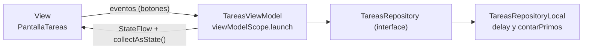
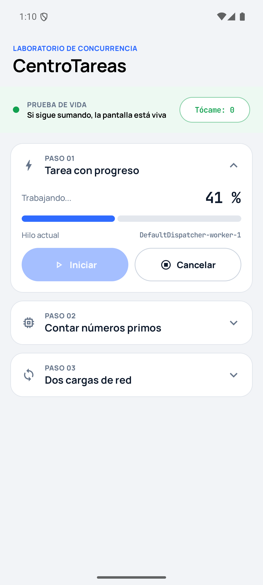
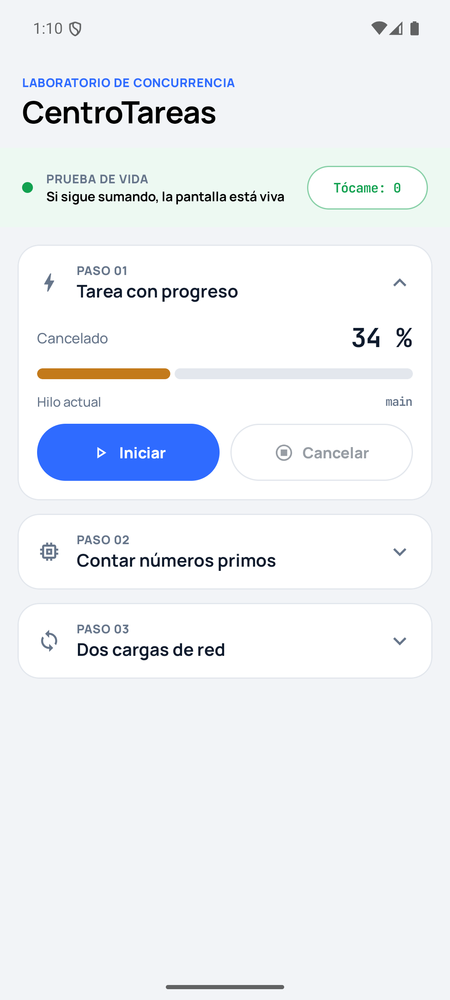
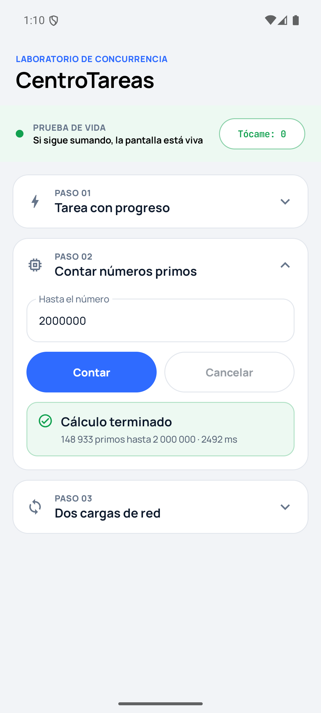
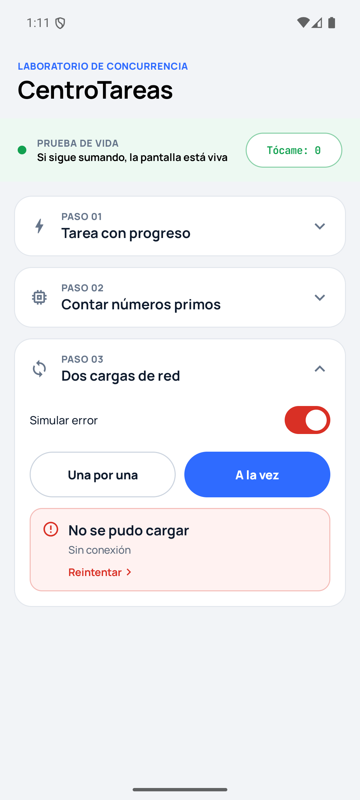
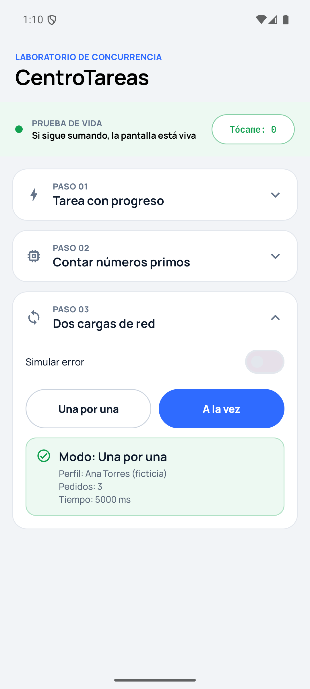
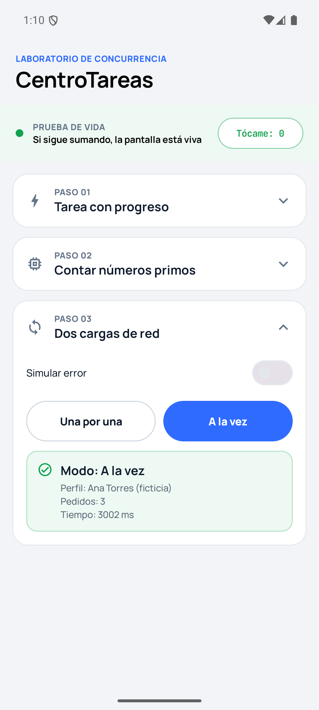
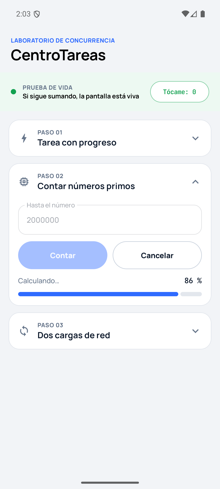
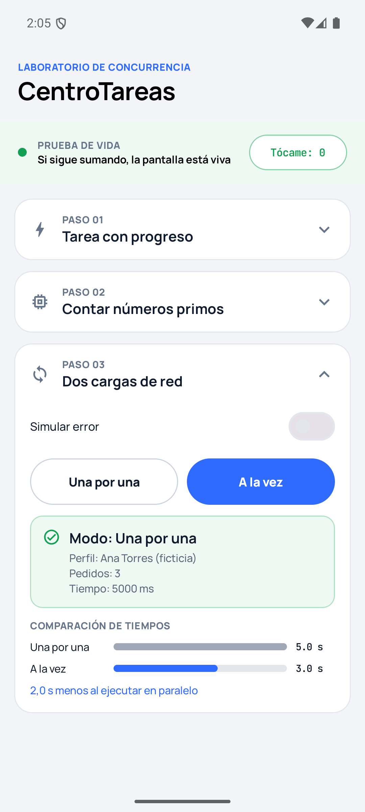

# CentroTareas

Laboratorio 14 de Programación en Móviles (Tecsup, docente Juan León): **Hilos en Android**.
Autor: Victor Santamaria.

CentroTareas hace tres cosas que tardan y muestra cómo hacerlas **sin congelar la pantalla**: una tarea con barra de progreso que se puede cancelar, un cálculo pesado (contar primos) y dos cargas de datos simuladas, una por una contra en paralelo. Todo con corrutinas, `ViewModel` y `StateFlow`, en Kotlin + Jetpack Compose + Material 3 (sin XML). Los datos son ficticios y no hace falta internet ni permisos.

La prueba de vida de la app es el botón **Tócame: n** de la franja verde: si deja de sumar, el hilo principal está bloqueado.

## Estructura

```
com.santamaria.centrotareas/
├── MainActivity.kt
├── model/
│   └── Estados.kt                  PrimosUi, CargaUi
├── data/
│   ├── TareasRepository.kt         interface
│   └── TareasRepositoryLocal.kt    cargas simuladas con delay y contarPrimos
├── viewmodel/
│   ├── TareasViewModel.kt          corrutinas, Job, StateFlow
│   └── TareasViewModelFactory.kt
└── ui/
    ├── PantallaTareas.kt           las tres tarjetas
    ├── components/                 botones, caja de mensaje, tarjeta de paso, franja de vida
    └── theme/                      colores, tipografía y formas del diseño
```

## Arquitectura (MVVM + Repository)



- La **View** solo muestra estado y avisa eventos; no lanza corrutinas.
- El **ViewModel** lanza el trabajo con `viewModelScope` y expone el estado; no conoce Composables ni `Context`.
- El **Repository** hace el trabajo pesado en segundo plano (`withContext(Dispatchers.Default)`) y no sabe nada de la pantalla.
- No hay `GlobalScope`, `runBlocking` ni `Thread.sleep` en el código final (`git grep` limpio).

## Observación del Paso 1

Con **Tarea larga (MAL)** el `Thread.sleep(4000)` corre en el **hilo principal**, que es el mismo que dibuja la pantalla y atiende los toques. Durante 4 segundos la pantalla quedó congelada: **Tócame** no respondía (los toques quedaron en cola y se contaron recién al terminar) y el texto **Trabajando...** nunca llegó a verse. Cuando el hilo se liberó, la pantalla ya decía **Terminó**.

Si la espera fuera de 10 segundos, Android mostraría el diálogo **"La aplicación no responde" (ANR)**, porque una app que no atiende un toque en unos 5 s se considera colgada. *(Esto último es lo que se sabe de Android; no se probó en el emulador.)*

## Capturas

| Tarea con progreso | Cancelada |
|---|---|
|  |  |

| Contar primos | Error simulado |
|---|---|
|  |  |

| Una por una (≈ 5 s) | A la vez (≈ 3 s) |
|---|---|
|  |  |

## Pruebas de aceptación (emulador)

| Prueba | Resultado |
|---|---|
| Tarea larga: tocar **Tócame** mientras trabaja | El contador sigue sumando |
| Logcat con filtro `HILO` | `Antes: main`, `Dentro: DefaultDispatcher-worker-1`, `Despues: main` |
| Iniciar la tarea con progreso | La barra avanza de 0 a 100 % en ≈ 4 s |
| Cancelar a mitad | La barra se detiene (34 % en la prueba), dice **Cancelado** y se puede iniciar otra vez |
| Pulsar **Iniciar** dos veces seguidas | No se lanzan dos tareas (el botón queda deshabilitado) |
| Primos hasta 100, 1000 y 10 000 | 25, 168 y 1229 |
| Primos hasta 500 000 | 41 538 (602 ms en el emulador) |
| Primos con N grande | La pantalla no se congela y **Cancelar** funciona |
| Una por una | 5000 ms y resultado correcto |
| A la vez | 3003 ms y resultado correcto |
| Error simulado + **Reintentar** | Recuadro rojo; al desactivar el interruptor y reintentar, éxito |
| Rotar la pantalla durante la tarea | La tarea continúa y el progreso no se reinicia (el `ViewModel` sobrevive) |
| Revisar el código | `git grep` no encuentra `GlobalScope`, `runBlocking` ni `Thread.sleep` |

El valor por defecto del campo de primos es **2 000 000** (no 500 000): con 500 000 el cálculo tardaba 0,6 s en el emulador y la guía pide que tarde entre 2 y 5 s para notar que la pantalla no se congela (2 000 000 → ≈ 2,5 s).

## Fase 2 · Mejoras con IA (rama `con-ia`)

Hechas con Claude Code, detalle de los prompts en [`PROMPTS.md`](PROMPTS.md). Cada una es un commit aparte y se probó en el emulador.

| # | Mejora | Capas que cambian | Commit |
|---|---|---|---|
| 1 | La tarea con progreso vive en el Repository y se expone como `Flow` con `flowOn(Dispatchers.Default)` | Repository + ViewModel | `2d52854` |
| 2 | Contar primos muestra el porcentaje mientras avanza (`Flow<AvancePrimos>` desde el Repository) | Repository + ViewModel + View | `cd0caf0` |
| 3 | Comparación de tiempos: barras de Una por una y A la vez y el ahorro en paralelo | ViewModel + View | `8e5649d` |

Se evaluó y **se descartó** el "tiempo máximo" con `withTimeout`: las cargas simuladas tardan 2 s y 3 s fijos, así que con un límite de 2 s fallarían siempre y no demostraría nada.

| Primos con progreso | Comparación de tiempos |
|---|---|
|  |  |

## Para pensar

**1. ¿Por qué no se veía "Trabajando..." en el Paso 1?**
Cambiar el `mensaje` solo actualiza el estado; la pantalla se redibuja en el siguiente ciclo del hilo principal. Como ese hilo estaba dormido en `Thread.sleep`, no pudo dibujar nada hasta que terminó, y para entonces el mensaje ya era **Terminó**.

**2. ¿Qué diferencia hay entre `Thread.sleep` y `delay`?**
`Thread.sleep` bloquea el hilo: mientras duerme no puede hacer nada más. `delay` es una función `suspend`: suspende la corrutina, libera el hilo para otro trabajo y la reanuda después. Además `delay` revisa la cancelación, así que la corrutina se puede cancelar mientras espera.

**3. ¿Por qué `Dispatchers.Default` para los primos y `Dispatchers.IO` para la red?**
`Default` tiene tantos hilos como núcleos y sirve para trabajo que usa procesador (contar primos): más hilos no lo harían más rápido. `IO` tiene un grupo grande de hilos pensado para trabajo que **espera** (red, disco), donde los hilos pasan casi todo el tiempo bloqueados esperando respuesta. En este laboratorio las cargas son simuladas con `delay`, que no bloquea ningún hilo, así que el código final no necesita `Dispatchers.IO`; en una app con red real, el Repository haría la llamada dentro de `withContext(Dispatchers.IO)`.

**4. ¿Qué pasaría con la corrutina si el usuario cierra la pantalla? ¿Qué papel cumple `viewModelScope`?**
`viewModelScope` está atado al ciclo de vida del `ViewModel`: cuando el usuario sale de verdad de la pantalla y el `ViewModel` se destruye (`onCleared`), el scope se cancela y con él todas sus corrutinas. Así no quedan trabajos huérfanos gastando batería ni escribiendo en una pantalla que ya no existe. Al **rotar**, en cambio, el `ViewModel` sobrevive y la tarea sigue.

**5. ¿Por qué `async` tarda 3 s y no 5 s? ¿Qué pasa si una de las dos cargas falla?**
Con `async` las dos cargas arrancan al mismo tiempo, así que el total es el de la más lenta: máx(2 s, 3 s) = 3 s, en vez de la suma 2 s + 3 s = 5 s. Como van dentro de `coroutineScope`, si una falla la excepción cancela a la otra y llega al `await()`, donde el `try/catch` la convierte en el estado **Error** con su botón **Reintentar**; la app no se cierra.
