# AvisosCampus

Laboratorio 15 de Programación en Móviles (Tecsup, docente Juan León): **Notificaciones en Android**.
Autor: Victor Santamaria.

AvisosCampus muestra notificaciones y escucha lo que pasa en el celular. Con un botón muestra un aviso, con otro programa un recordatorio que llega a los 10 segundos y avisa cuando el usuario activa o desactiva el modo avión. Todo queda anotado en un historial. Kotlin + Jetpack Compose + Material 3 (sin XML), notificaciones locales y `BroadcastReceiver`. Los datos son ficticios y no necesita internet.

## Estructura

```
com.santamaria.avisoscampus/
├── AvisosApp.kt                    Application: crea el canal
├── MainActivity.kt
├── model/
│   └── Modelos.kt                  Aviso, Origen, PermisoUi
├── data/
│   └── AvisosRepository.kt         interface + AvisosRepositoryMemoria
├── notificacion/
│   └── Notificador.kt              canal, permiso y mostrar
├── receiver/
│   └── ModoAvionReceiver.kt        escucha el modo avión
├── viewmodel/
│   ├── AvisosViewModel.kt          decide qué avisar, recordatorio, receptor
│   └── AvisosViewModelFactory.kt
└── ui/
    ├── PantallaAvisos.kt           las tarjetas
    ├── HistorialAvisos.kt          lista del historial
    └── theme/
```

## Arquitectura (MVVM + Repository)

```
View (PantallaAvisos)
  |  eventos: botones, switch         ^  collectAsState()
  v                                   |
ViewModel (AvisosViewModel) --- StateFlow (avisos, permiso, faltan...) --->
  |  registra el aviso                |  emite: eventos (SharedFlow<Aviso>)
  v                                   v
AvisosRepository (interface)    View recibe el evento y llama a
  -> AvisosRepositoryMemoria      Notificador.mostrar(context, aviso)
```

El ViewModel decide qué avisar y lo anota en el Repository; después emite un evento. La pantalla (que sí tiene `Context`) lo recibe y llama al `Notificador`. Así el ViewModel no usa `Context`, `NotificationManager` ni `BroadcastReceiver`.

## Capturas

**1. Notificación en el panel** (dos avisos seguidos: llegan dos notificaciones distintas porque cada una usa el id de su aviso)

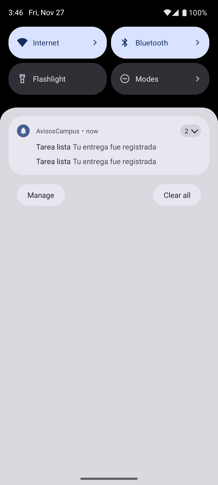

**2. Recordatorio** (cuenta regresiva, botón deshabilitado mientras corre y Cancelar habilitado)

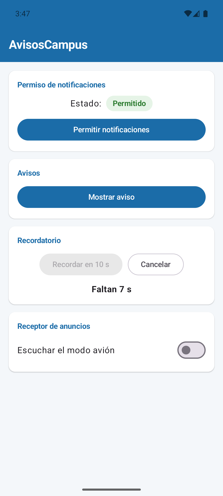

**3. Modo avión** (el receptor avisa Activado y Desactivado)

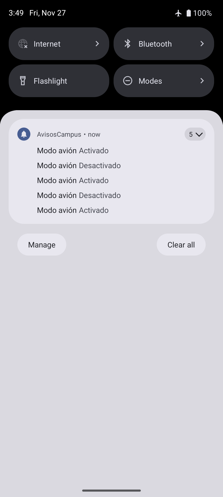

**4. Historial** (lo más reciente arriba, con origen, texto y hora)

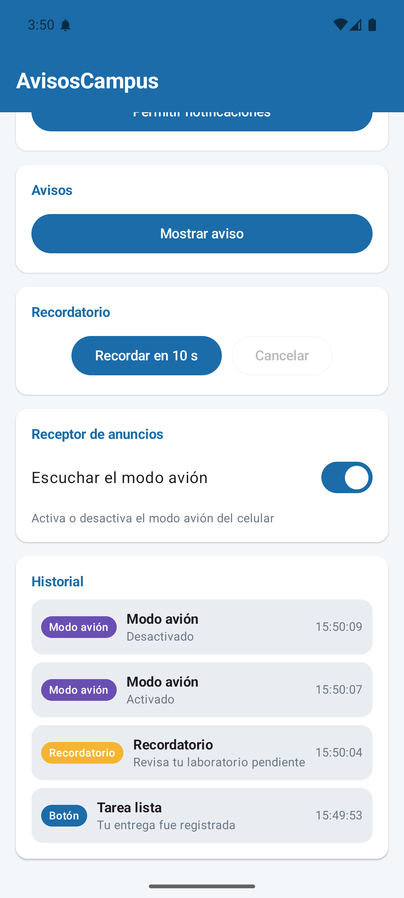

**5. Permiso denegado** (el aviso se guarda pero no se muestra; botón Abrir ajustes)

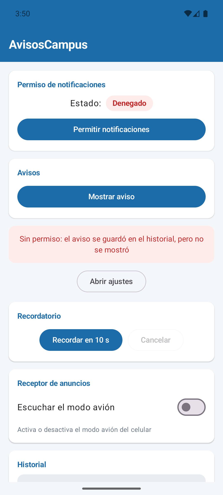

## Pruebas de aceptación (emulador Android 16, API 36)

| Prueba | Resultado |
|---|---|
| Ajustes → Apps → AvisosCampus → Notificaciones | Existe el canal **Avisos** |
| Pulsar **Permitir notificaciones** | Aparece el cuadro de Android y la etiqueta cambia (Permitido / Denegado) |
| Pulsar **Mostrar aviso** | Aparece la notificación **Tarea lista** |
| **Mostrar aviso** dos veces | Aparecen dos notificaciones distintas |
| Tocar la notificación (app cerrada) | Se abre la app y la notificación desaparece |
| Recordar en 10 s | Cuenta regresiva y aviso al llegar a 0 |
| Recordar y minimizar la app | El aviso llega igual |
| Recordar y cancelar | No llega ningún aviso |
| Switch activado y cambiar el modo avión | Aviso **Activado** y luego **Desactivado** |
| Switch desactivado y cambiar el modo avión | No hay aviso |
| Permiso denegado y **Mostrar aviso** | Mensaje de error, aviso en el historial y la app no se cierra |
| Rotar la pantalla (switch activado) | El receptor sigue escuchando y el historial se conserva |
| Rotar la pantalla durante el recordatorio | La cuenta regresiva continúa (sigue en "Faltan 6 s", no se reinicia a 10) y el aviso llega al llegar a 0 |
| Revisar el código | No hay `Context` en `viewmodel/`; el receptor se quita en `onDispose` |

Rotación durante el recordatorio (la cuenta vive en el `viewModelScope`, por eso no se reinicia):

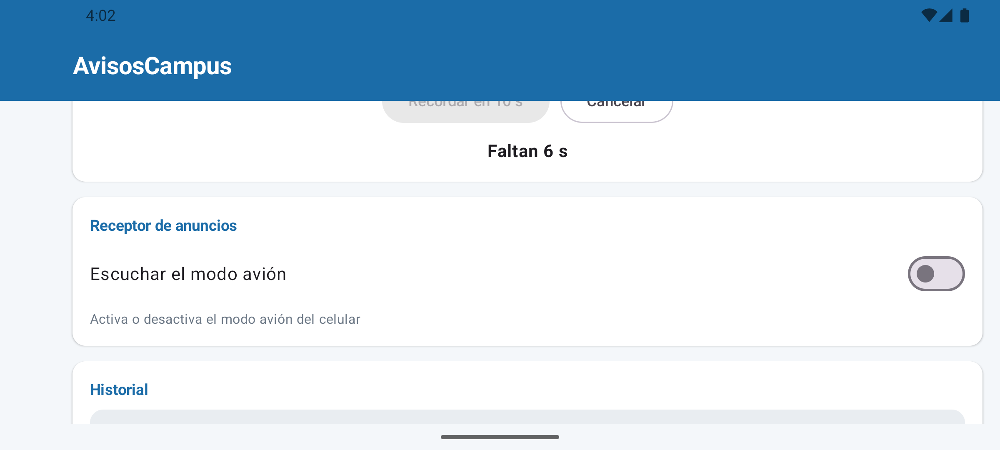

## Para pensar

1. **¿Por qué una notificación necesita un canal y un permiso? ¿Qué pasa si falta cada uno?**
   Desde Android 8 toda notificación pertenece a un canal: es lo que el usuario ve y configura en Ajustes (sonido, importancia). Sin canal, la notificación no se muestra. Desde Android 13 además hace falta el permiso `POST_NOTIFICATIONS` en tiempo de ejecución: sin él, `notify` no muestra nada (y la app no se cae si lo comprobamos antes).

2. **¿Por qué el ViewModel emite un evento y no muestra la notificación él mismo?**
   Porque mostrarla requiere `Context` y `NotificationManager`, y el ViewModel no debe tenerlos: sobrevive a la rotación y un `Context` de Activity filtraría memoria. Además así se puede probar sin Android. El ViewModel decide y anota; la pantalla muestra.

3. **¿Qué pasa si usas el mismo id en dos notificaciones?**
   La segunda reemplaza a la primera: solo se ve una. Por eso se usa el id del aviso, para que cada una sea distinta.

4. **¿Por qué `onReceive` debe ser corto y por qué hay que quitar el receptor al salir?**
   `onReceive` corre en el hilo principal y el sistema espera que termine rápido; el trabajo largo bloquearía la app. Y un receptor registrado por código sigue vivo hasta que se quita: si no se hace `unregisterReceiver` en `onDispose`, mantiene referencias a la pantalla y filtra memoria (y puede seguir recibiendo anuncios sin necesidad).

5. **¿En qué casos usarías una notificación local y en cuáles una push de Firebase?**
   Local: cuando el aviso nace dentro del propio celular (recordatorios, temporizadores, el resultado de una tarea, cambios del sistema como el modo avión). Push: cuando el aviso lo origina un servidor y el celular no sabe que existe (mensaje nuevo de otra persona, una promoción, un cambio de estado en la nube), incluso con la app cerrada.

## Fase 2 (rama `con-ia`): mejoras

Detalle de los prompts en [PROMPTS.md](PROMPTS.md).

1. **Dos canales**: el recordatorio usa el canal **Urgentes** (`IMPORTANCE_HIGH`, emergente) y lo demás el canal **Avisos**. Cambian `Notificador`, `Aviso`, el Repository y el ViewModel.

   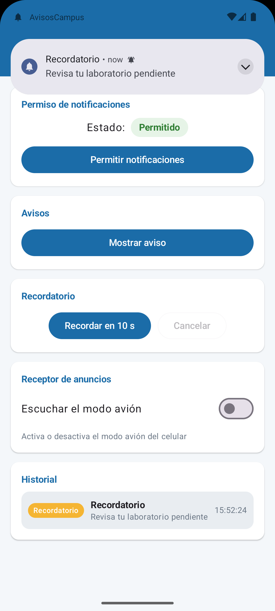

2. **Texto largo** con `BigTextStyle`: al expandir la notificación se ve el texto completo con origen y hora. Cambia solo `Notificador`.

   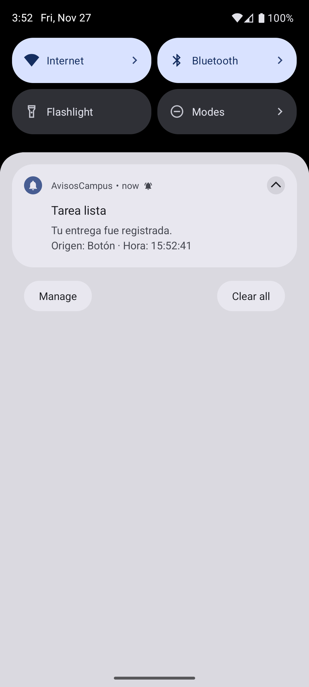

3. **Historial persistente** con DataStore: el historial no se pierde al cerrar la app. Cambia el Repository (`AvisosRepositoryDataStore`) y la creación en `MainActivity`.

   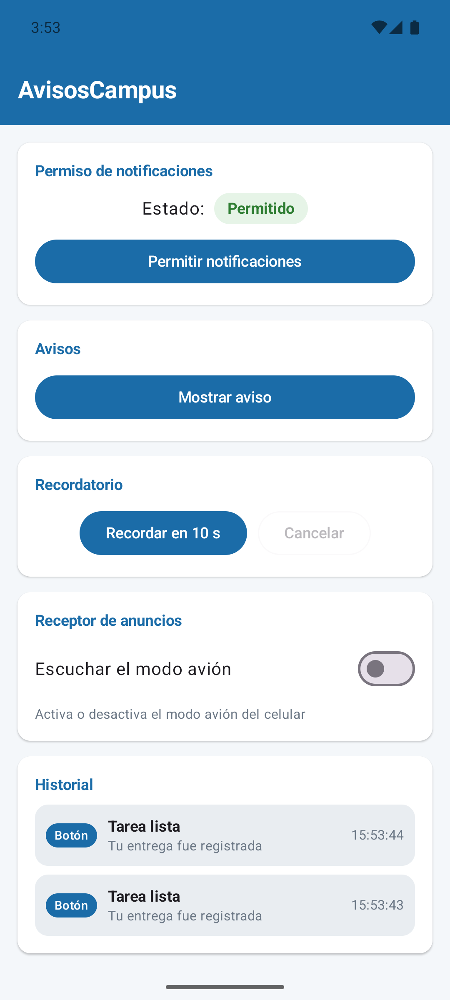

4. **Rediseño de la pantalla** (diseño hecho en Figma Make, pasado a Compose): cabecera marino con acento lima, tarjetas numeradas, anillo en la cuenta regresiva, filtros por origen en el historial y estados vacío y de error. Respeta la barra de estado, la cámara y la barra de gestos, con franjas fijas para que el contenido no pase por debajo de los íconos del sistema. Solo cambia la capa de interfaz (`ui/`, tema, íconos y fuentes) y el color y la descripción de los canales en el `Notificador`; el ViewModel y el Repository no cambian.

   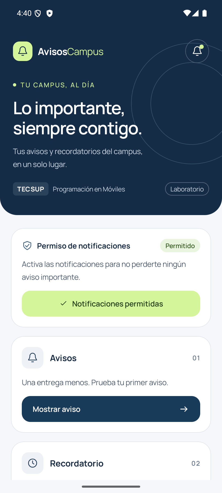
   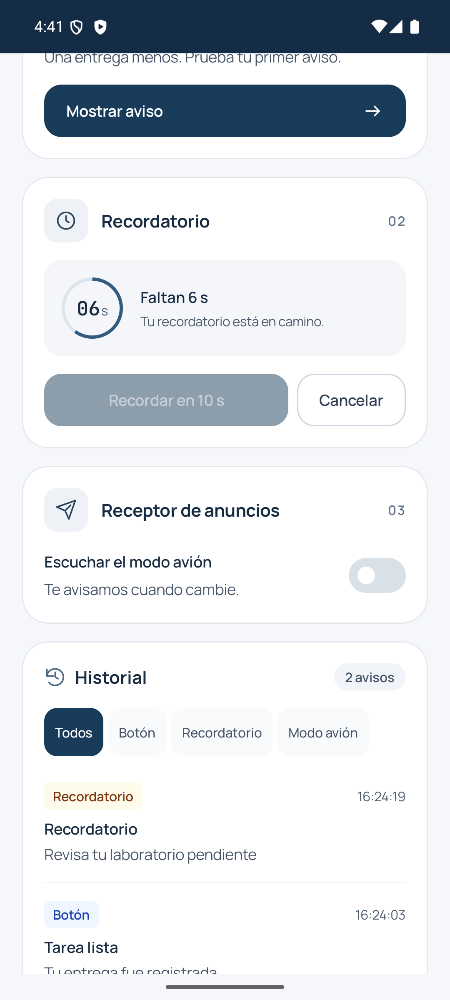
   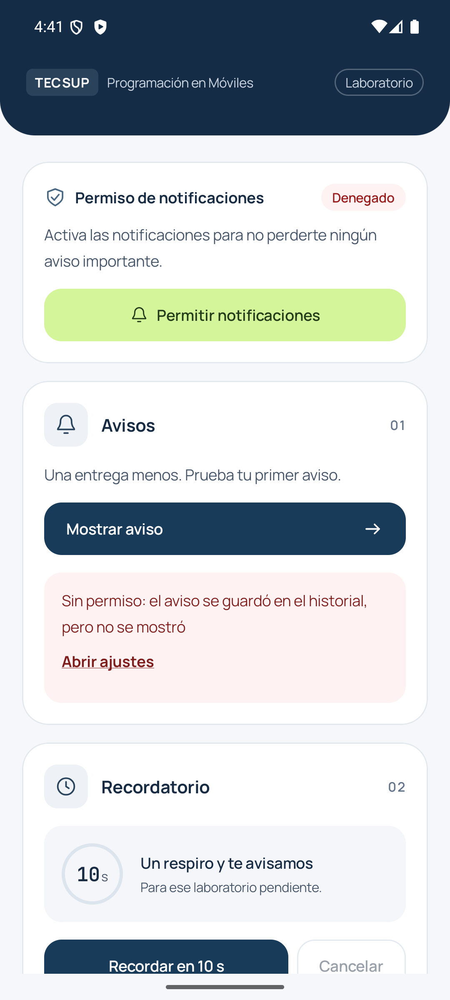
